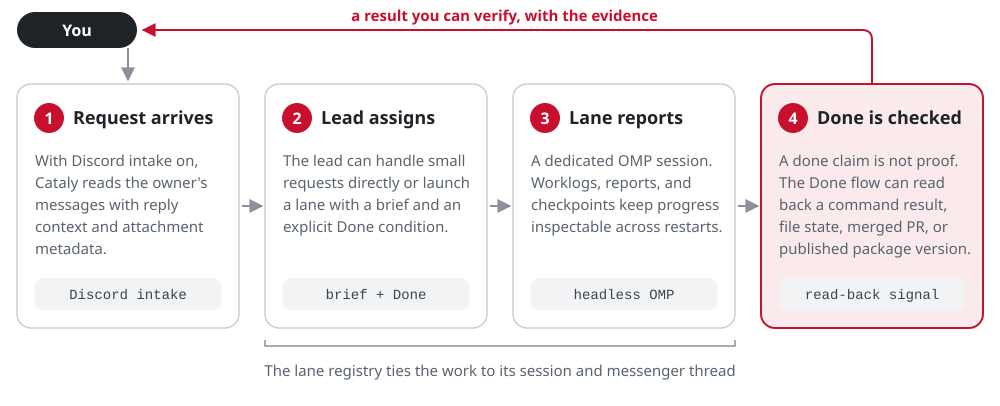

<p align="center">
  
</p>

<h1 align="center">Cataly</h1>

<p align="center">
  <strong>Die Absicht verstehen. Den Kontext erfassen. Die Arbeit zu Ende bringen.</strong>
</p>

<p align="center">
  Cataly ist ein KI-Teammitglied, das aus einem Ziel ein fertiges Ergebnis macht.
  Sag ihm, was du erreichen möchtest: Es übernimmt die nächsten Schritte,
  berücksichtigt den Kontext und führt die Arbeit bis zu einem überprüfbaren Ergebnis.
</p>

<p align="center">
  <a href="https://github.com/vntrevx/Cataly/releases"></a>
  <a href="https://github.com/vntrevx/Cataly/actions/workflows/ci.yml?query=branch%3Amain"></a>
  <a href="LICENSING.md"></a>
  <a href="https://bun.sh"></a>
</p>

<p align="center">
  <a href="#erste-schritte"><strong>Erste Schritte</strong></a> ·
  <a href="#so-funktioniert-es"><strong>So funktioniert es</strong></a> ·
  <a href="#dokumentation"><strong>Dokumentation</strong></a> ·
  <a href="#mitwirken"><strong>Mitwirken</strong></a>
</p>

<p align="center">
  <a href="README.md">English</a> · <a href="README.ko.md">한국어</a> · <a href="README.ja.md">日本語</a><br>
  <strong>Deutsch</strong> · <a href="README.it.md">Italiano</a> · <a href="README.zh.md">中文</a>
</p>

## Die Philosophie

Der Anspruch geht über das Befolgen von Anweisungen hinaus. Es geht um gutes
Urteilsvermögen: erkennen, worauf es ankommt, Details miteinander verbinden und
die Arbeit erledigen, ohne bei jedem Schritt angeleitet werden zu müssen.

<table>
  <tr>
    <td width="50%" valign="top">
      <h4>Verantwortung für das Ergebnis übernehmen</h4>
      Auf das Ziel hinarbeiten, statt eine Liste von Tätigkeiten abzuhaken.
    </td>
    <td width="50%" valign="top">
      <h4>Den Kontext verstehen</h4>
      Gespräch, Projektkonventionen, Einschränkungen und die Vorlieben des Nutzers
      im Blick behalten.
    </td>
  </tr>
  <tr>
    <td width="50%" valign="top">
      <h4>Überlegt die Initiative ergreifen</h4>
      Alltägliche Entscheidungen selbst treffen. Nachfragen, wenn eine echte
      Abwägung oder eine fehlende Erlaubnis das Urteil des Nutzers erfordert.
    </td>
    <td width="50%" valign="top">
      <h4>Die Arbeit zu Ende bringen</h4>
      Untersuchen, umsetzen, prüfen und berichten, was tatsächlich passiert ist.
      Eine überzeugende Erklärung ersetzt kein funktionierendes Ergebnis.
    </td>
  </tr>
</table>

An diesem Maßstab orientiert sich Cataly: fähig genug, um zu handeln, aufmerksam
genug, um zu verstehen, und verantwortlich für das Ergebnis.

## So funktioniert es

<picture>
  <source media="(prefers-color-scheme: dark)" srcset="docs/how-it-works-dark.svg">
  <source media="(prefers-color-scheme: light)" srcset="docs/how-it-works-light.svg">
  
</picture>

Cataly verbindet Messenger-Unterhaltungen mit einer nativen Laufzeit für
Coding-Agents und nachverfolgbaren Arbeits-Lanes:

- Der Lead erledigt kleine Anfragen direkt und gibt längeren Aufgaben ein Briefing,
  eine eigene Session und einen klar benannten Verantwortlichen.
- Arbeitsprotokolle, Checkpoints und Registries halten den Fortschritt auch über Neustarts hinweg einsehbar.
- Die Discord-Annahme übernimmt den Antwortkontext und Metadaten von Anhängen in die Arbeit.
- Prozessgebundene Session- und Freigabeeinträge sichern die Zustellung an den vorgesehenen Agenten ab.
- Abschlussprüfungen können konkrete Signale prüfen, etwa erfolgreiche Befehle,
  übereinstimmende Dateien, gemergte Pull Requests oder veröffentlichte Versionen.
- Optionale Zeitplanung, Monitore und übergeordnete Überwachung unterstützen
  laufende Arbeit, wenn sie ausdrücklich aktiviert werden.

Die Implementierung ist von
[dori-superagent](https://github.com/sisyphuslabs/dori-superagent) abgeleitet und
baut auf [oh-my-pi](https://github.com/can1357/oh-my-pi) auf. Ihre Autoren,
Lizenzen und Quellnachweise bleiben Bestandteil des Projekts.

## Betriebsgrundsätze

Cataly arbeitet mit den Konten und Berechtigungen, die du bereitstellst.
Externe Auswirkungen erfordern die jeweils nötige Autorisierung; die Einschätzung,
dass eine Aktion hilfreich wäre, erteilt keine Erlaubnis. Aktiviere nur die
Sessions, Monitore und Dienste, die du ausführen möchtest.

Prüfungen haben Grenzen. Ein erfülltes Abschlusssignal ist ein Beleg für dieses
Signal, keine Garantie für sämtliche Ergebnisse. Berichte sollten beobachtete
Ergebnisse, verbleibende Unsicherheit und nicht ausgeführte Arbeiten unterscheiden.

Halte Zugangsdaten, private Unterhaltungen und Kontodaten aus öffentlichen Patches
und Berichten heraus. Telemetrie ist standardmäßig aus. `CATALY_TELEMETRY=1`
aktiviert sie; `DO_NOT_TRACK=1` hat Vorrang.

## Erste Schritte

<table width="100%"><tr><td>

**Cataly ist ein neues Produkt, kein Upgrade von omp-dori**

Diese Version entfernt alle omp-dori-Namen, die Terminal-Laufzeiten herdr und hc
sowie das omp-ulw-Overlay, und obwohl sich omp-dori-Code nicht direkt aktualisieren
lässt, übernimmt der Installer den Umzug selbst: Er übernimmt Konfiguration, Tokens
und Besitzerprofil eines bisherigen `~/.dori`- oder `~/.omp-dori`-Verzeichnisses in
das neue Installationsverzeichnis, ohne dort vorhandene Einstellungen zu
überschreiben, und löscht danach das bisherige Verzeichnis sowie die Links und
Caches der bisherigen Version, sobald nichts daraus mehr läuft
([So läuft der Umzug](docs/releases.md#cataly-is-a-new-product-moving-from-omp-dori)).

Die aktuellen Befehle heißen `cataly`, `cataly-harness` und `omp-cataly` (separate
Installation). Neue Installationen verwenden `~/.cataly` beziehungsweise
`~/.omp-cataly`. Cataly läuft unter macOS und Linux standardmäßig auf headless OMP;
Tern ist die optionale Terminal-Laufzeit.

</td></tr></table>

### Ein veröffentlichtes Release nutzen

Folge der [geprüften Anleitung für ein aktuelles Release](docs/releases.md#install-a-current-release).
Sie behandelt Voraussetzungen, Prüfsummen, Installation, deine eigene
Authentifizierung, den ausdrücklichen Start und optional aktivierte Discord-Monitore.
Ersetze ein exaktes Release nicht durch einen beliebigen Installer von `main`.

### Mit dem Quellcode arbeiten

Installiere zuerst git und Bun 1.4.4+ unter Linux oder macOS; ein Terminal-Server ist nicht nötig. Siehe die
[Voraussetzungen für die Quellcode-Version](docs/releases.md#current-source-bundle).
Tern ist die optionale Terminal-Laufzeit; siehe [Tern](docs/runtime.md#tern).

Verwende einen separaten Checkout, keine laufende Installation und kein eingefrorenes Endnutzer-Release:

```bash
git clone https://github.com/vntrevx/Cataly.git "$HOME/src/Cataly" || exit 1
cd "$HOME/src/Cataly" || exit 1
CATALY_INSTALL_MODE=side CATALY_NO_PULL=1 CATALY_SRC="$PWD" bash scripts/install-source.sh
```

Der Source-Installer richtet das fest zugeordnete, gepatchte OMP 19.0.1 ein; ein
unverändertes `omp` auf `PATH` ist kein Ersatz. Der Side-Modus
verwendet standardmäßig `~/.omp-cataly`, hat eigene Wrapper und eine eigene
Konfiguration und lässt die primäre Installation unter `~/.cataly` unberührt.
Die Installation startet weder Agenten noch Messenger-Empfänger oder Dienste.

Lies die [Anleitung zur Source-Installation](docs/releases.md#source-checkouts-for-maintainers)
zu Isolation, Konfiguration und ausdrücklichem Start.
Native Sessions nutzen deine eigene Provider-Authentifizierung und dein Nutzungskontingent.

<table width="100%"><tr><td>

**Wichtig**

Die Endnutzer-Implementierung unterstützt auch isolierte headless Profile für macOS arm64,
wenn ein geprüftes Release-Manifest sie ausweist. Das bedeutet nicht, dass ein
macOS-Release veröffentlicht wurde. Slack und Telegram bleiben Funktionen der Quellcode-Version.

</td></tr></table>

## Dokumentation

- [Installation, Support, Updates und Rollback](docs/releases.md)
- [Skill und Betriebsregeln](skills/cataly-mode/SKILL.md)
- [Messenger-Einrichtung](skills/cataly-mode/references/setup.md)
- [Laufzeitadapter und Session-Verträge](docs/runtime.md)
- [Container-Einrichtung](docs/container.md)
- [Zeitplanung und Backlog](docs/hourly-loop.md)
- [Gemeinsame Sperren und Lane-Priorität](docs/locks.md)
- [Mitwirken](CONTRIBUTING.md)
- [Änderungsprotokoll](CHANGELOG.md)
- [Lizenzen und Quellnachweise](LICENSE) · [Lizenzleitfaden](LICENSING.md) · [Hinweis zur modifizierten Kopie](NOTICE)

## Mitwirken

Bring ein klares Ziel, eine gezielte Änderung und Belege dafür mit, dass sie funktioniert.
Beginne mit dem [Beitragsleitfaden](CONTRIBUTING.md), prüfe
[bestehende Issues](https://github.com/vntrevx/Cataly/issues) und
[Pull Requests](https://github.com/vntrevx/Cataly/pulls) und bewahre den Kontext,
der die Änderung nötig gemacht hat.

## Lizenz

Die Lizenzierung richtet sich nach der Herkunft der einzelnen Komponenten.
Von dori-superagent abgeleitetes Material behält die
[Sustainable Use License 1.0](LICENSE); die bereits bestehende OMP-Integration
behält ihre [MIT-Lizenz und Urheberrechtshinweise](LICENSE.integration).
Andere Komponenten behalten ihre eigenen Bedingungen. Der MIT-Hinweis lizenziert
nicht das gesamte Repository neu. [NOTICE](NOTICE) dokumentiert die importierten
Revisionen und die Urheber- und Herkunftsangaben zur modifizierten Kopie.
