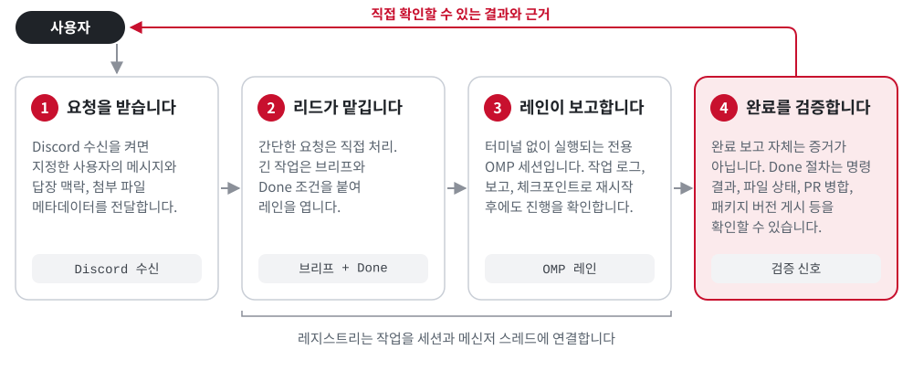

<p align="center">
  
</p>

<h1 align="center">Cataly</h1>

<p align="center">
  <strong>의도를 이해하고 맥락을 읽어 끝까지 해냅니다.</strong>
</p>

<p align="center">
  Cataly는 개발 업무를 함께하는 AI 동료입니다.
  단계별 지시 대신 목표와 지켜야 할 조건을 알려주세요.
  Discord에서 요청을 받아 전용 코딩 세션에서 작업하고,
  직접 확인할 수 있는 결과를 돌려줍니다.
</p>

<p align="center">
  <a href="https://github.com/vntrevx/Cataly/releases/tag/v0.1.2"></a>
  <a href="https://github.com/vntrevx/Cataly/actions/workflows/ci.yml?query=branch%3Amain"></a>
  <a href="LICENSING.md"></a>
  <a href="https://bun.sh"></a>
</p>

<p align="center">
  <a href="#시작하기"><strong>시작하기</strong></a> ·
  <a href="#작동-방식"><strong>작동 방식</strong></a> ·
  <a href="#문서"><strong>문서</strong></a> ·
  <a href="#기여하기"><strong>기여하기</strong></a>
</p>

<p align="center">
  <a href="README.md">English</a> · <strong>한국어</strong> · <a href="README.ja.md">日本語</a><br>
  <a href="README.de.md">Deutsch</a> · <a href="README.it.md">Italiano</a> · <a href="README.zh.md">中文</a>
</p>

## 목표부터 알려주세요

<table width="100%"><tr><td>

**요청 예시**

*로그인 테스트가 간헐적으로 실패하는 이유를 찾아줘. 공개 API는 그대로 두고,
관련 테스트를 돌린 다음 원인과 검증 결과를 담아 PR을 열어줘.*

</td></tr></table>

<table>
  <tr>
    <td width="33%" valign="top">
      <h4>의도를 이해합니다</h4>
      간헐적 실패는 증상입니다. 공개 API를 유지하면서 검토할 수 있는 수정안을
      만드는 것이 목표입니다. 목표가 조사 범위를 결정합니다.
    </td>
    <td width="33%" valign="top">
      <h4>맥락을 읽습니다</h4>
      대화, 저장소 관례, 제약, 사용자가 밝힌 선호를 함께 고려합니다. 일상적인
      판단은 Cataly가 맡고, 실질적인 절충이나 권한 판단이 필요할 때는 묻습니다.
    </td>
    <td width="33%" valign="top">
      <h4>끝까지 완수합니다</h4>
      패치를 만드는 것으로 끝내지 않습니다. 합의한 결과를 확인하고, 근거와 아직
      확인하지 못한 부분을 함께 보고합니다.
    </td>
  </tr>
</table>

차이는 채팅 화면이 아니라, 요청과 실제 작업 세션, 그리고 완료를 뒷받침하는 근거가
서로 연결된다는 데 있습니다.

## 작동 방식

<picture>
  <source media="(prefers-color-scheme: dark)" srcset="docs/how-it-works.ko-dark.svg">
  <source media="(prefers-color-scheme: light)" srcset="docs/how-it-works.ko-light.svg">
  
</picture>

아래는 현재 `main`의 작업 흐름입니다.

1. **요청을 받습니다.** Discord 수신을 켜면 지정한 사용자의 메시지를 읽고,
   확인할 수 있는 답장 맥락과 첨부 파일 메타데이터를 함께 전달합니다.
2. **리드가 작업을 맡깁니다.** 간단한 요청은 직접 처리합니다. 긴 작업에는 브리프와
   명시적인 `Done` 조건을 붙여 **레인**을 엽니다. 레인은 herdr 또는 hc에서 실행되는
   전용 [oh-my-pi(OMP)](https://github.com/can1357/oh-my-pi) 코딩 세션입니다.
   레지스트리는 작업을 세션과 메신저 스레드에 연결합니다.
3. **레인이 작업하고 보고합니다.** 작업 로그·보고·체크포인트를 통해 재시작 후에도
   진행 상황을 확인할 수 있습니다. Discord 채널이 레인 하나에 연결돼
   있으면 일반 채팅은 해당 레인의 OMP 세션으로 전달됩니다. 지원되는 ASK 양식에
   직접 답장하면 새 작업을 시작하는 대신 열린 질문에 답합니다.
4. **완료를 검증합니다.** 레인의 완료 보고 자체가 증거는 아닙니다. Done 절차는
   명령 실행 결과, 파일 상태, PR 병합, 패키지 버전 게시 등을 확인할 수 있습니다.
   검증을 통과했다는 것은 확인한 항목의 증거이지 모든 결과를 보장한다는 뜻은 아닙니다.

## 통제권은 사용자에게 있습니다

- Cataly는 사용자가 제공한 계정과 권한으로 작동합니다. 도움이 될 것이라는 판단만으로
  외부 작업 권한이 생기지는 않습니다.
- 설치만으로 에이전트·메신저 수신기·서비스가 시작되지는 않습니다. 원하는 기능만
  활성화하세요.
- 인증 정보와 비공개 대화는 공개 보고에서 제외하세요.
- 선택적 텔레메트리는 `DORI_TELEMETRY=0` 또는 `DO_NOT_TRACK=1`로 끌 수 있습니다.

## 시작하기

<table width="100%"><tr><td>

**참고**

Cataly는 프로젝트 이름입니다. `dori`, `omp-dori`, `omp` 명령과 기존 설치 경로,
게시된 배포 파일 이름은 그대로입니다.

</td></tr></table>

|            | [게시된 프리릴리스](#게시된-프리릴리스-써보기) | [현재 소스](#현재-소스에서-시작하기)           |
| ---------- | ---------------------------------------------- | ---------------------------------------------- |
| **빌드**   | v0.1.2 프리릴리스                              | 현재 `main`                                    |
| **범위**   | Linux x64 / herdr / Discord                    | herdr 또는 hc, 선택한 메신저                   |
| **OMP**    | 별도로 설치한 네이티브 OMP 18.18.8             | 고정된 패치 버전 OMP 18.20.0과 omp-ulw 오버레이 |
| **설치 홈** | 기본 설치 홈 `~/.dori`                          | Side 모드 `~/.omp-dori`                        |

### 게시된 프리릴리스 써보기

[v0.1.2 프리릴리스](https://github.com/vntrevx/Cataly/releases/tag/v0.1.2)는
**Linux x64 / herdr / Discord** 환경을 대상으로 합니다. 검증 기준은 Ubuntu 24.04 x64,
Bun 1.4.4, 네이티브 OMP 18.18.8, herdr 0.9.5입니다. 별도로 설치한 OMP와 기본
설치 홈 `~/.dori`를 사용합니다. 현재 `main`의 새 기능과 도구 체인은 포함되지 않습니다.

1. [정확한 프리릴리스 설치](https://github.com/vntrevx/Cataly/blob/v0.1.2/docs/releases.md#install-the-exact-preview)를 따르세요.
   [사전 요구 사항](https://github.com/vntrevx/Cataly/blob/v0.1.2/docs/releases.md#prerequisites-and-trust)을 확인하고,
   같은 릴리스의 배포 파일을 검증한 뒤 설치기를 실행합니다.
2. [모델 제공업체와 Discord 봇을 설정한 뒤 Dori를 시작하세요](https://github.com/vntrevx/Cataly/blob/v0.1.2/docs/releases.md#your-authentication-and-explicit-startup).
   본인의 제공업체 계정과 사용량 한도, 봇 토큰, 사용자 ID, 채널 ID를 사용합니다.
3. [Discord 수신을 켜세요](https://github.com/vntrevx/Cataly/blob/v0.1.2/docs/releases.md#discord-owner-intake).
   `INBOUND_READY`가 표시된 뒤 설정한 채널에 새 메시지를 보내세요. 첫 시작 시에는
   이전 메시지를 다시 가져오지 않습니다.

### 현재 소스에서 시작하기

git, Bun 1.4.4 이상과 선택한 세션 런타임(herdr 또는 hc)을 준비해 별도 체크아웃을
사용하세요. 소스 설치기는 고정된 패치 버전 **OMP 18.20.0**과 **omp-ulw** 오버레이를
준비합니다. 기본 설치에는 사전에 설치한 OMP나 Cargo가 필요 없고, 일반 배포판 `omp`로
이 구성을 대체하지 않습니다.

```bash
git clone https://github.com/vntrevx/Cataly.git "$HOME/src/Cataly" || exit 1
cd "$HOME/src/Cataly" || exit 1
DORI_INSTALL_MODE=side DORI_NO_PULL=1 DORI_SRC="$PWD" \
  bash scripts/install-source.sh
```

Side 모드는 기본적으로 `~/.omp-dori`를 사용하며 기존 `~/.dori` 설치를 건드리지
않습니다. Side 홈 설정을 마친 뒤 `omp-dori omp`로 전용 래퍼를 사용하세요. 런타임별
구성과 실행은 [소스 설치 가이드](docs/releases.md#source-checkouts-for-maintainers)를
참고하세요. `omp-dori doctor`는 설정을 읽기 전용으로 점검하고, `omp-dori status`는
레인 상태를 보여줍니다.

<table width="100%"><tr><td>

**중요**

**지원 범위:** Slack과 Telegram은 소스에 남아 있는 연동 기능이며 게시된 프리릴리스의
지원 범위에 포함되지 않습니다. 호환 릴리스 매니페스트에 명시된 경우 격리된
macOS arm64 / hc 설치가 가능하지만, 해당 배포본이 게시됐다는 뜻은 아닙니다.
`main` 병합만으로 기존 프리릴리스가 업데이트되지는 않습니다.

</td></tr></table>

## 문서

| 설치와 운영                                                         | 더 알아보기                                                         |
| ------------------------------------------------------------------- | ------------------------------------------------------------------- |
| [설치, 지원, 업데이트와 롤백](docs/releases.md)                     | [런타임 어댑터와 세션 계약](docs/runtime.md)                        |
| [메신저 설정](skills/dori-mode/references/setup.md)                 | [소스 개발용 컨테이너](docs/container.md)                           |
| [Dori 운영 규칙](skills/dori-mode/SKILL.md)                         | [스케줄링과 백로그](docs/hourly-loop.md)                            |
| [레인 명령과 설정](skills/dori-mode/references/scripts.md)          | [공유 잠금과 레인 우선순위](docs/locks.md)                          |
| [완료 검증 절차](skills/dori-mode/references/done-protocol.md)      | [선택형 유료 Discord 음성 도우미(현재 소스)](docs/discord-voice.md) |
| [변경 기록](CHANGELOG.md)                                           |                                                                     |

## 기여하기

[기여 안내](CONTRIBUTING.md)에서 시작하고
[이슈](https://github.com/vntrevx/Cataly/issues)와
[PR](https://github.com/vntrevx/Cataly/pulls)을 확인하세요. 변경 범위를 분명히 하고,
작동을 확인한 근거를 함께 남겨주세요.

## 라이선스와 출처

Cataly는 [dori-superagent](https://github.com/sisyphuslabs/dori-superagent),
[oh-my-pi](https://github.com/can1357/oh-my-pi),
[omp-ulw](https://github.com/dbc-hbin/omp-ulw)를 결합합니다. dori-superagent에서
파생된 부분은 [Sustainable Use License 1.0](LICENSE)을 따릅니다. 기존 OMP 통합
부분은 [MIT 라이선스와 저작권 고지](LICENSE.omp-dori)를 유지하며, 이 MIT 고지는
저장소 전체에 적용되지 않습니다. 다른 구성 요소에는 각각의 조건이 적용됩니다.
가져온 소스의 리비전과 수정본 출처는 [라이선스 안내](LICENSING.md)와 [NOTICE](NOTICE)를
참고하세요.
